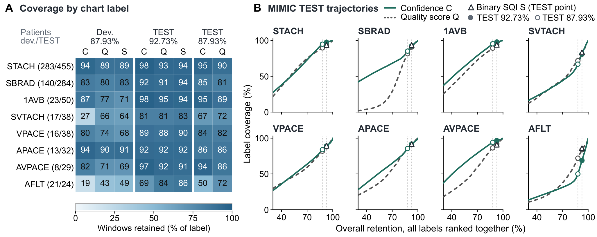
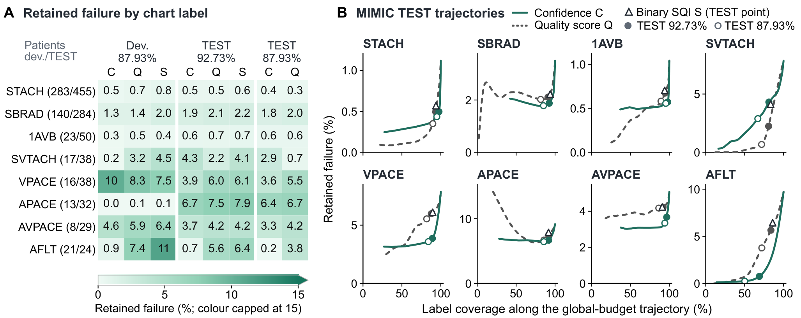

<h1 align="center"> Selective PPG Heart-Rate Reporting</h1>

<p align="center"><strong>Separating within-rhythm accuracy from reliable-output yield</strong></p>

<p align="center"><a href="https://orcid.org/0009-0002-4046-7302">Xianjin Lin</a><sup>1</sup> · <a href="https://orcid.org/0000-0003-2353-8615">Liyang Yu</a><sup>1†</sup> · Zhonglou Luo<sup>1</sup> · Rui Tian<sup>1</sup> · <a href="https://orcid.org/0000-0001-8932-6792">Wangcai Ding</a><sup>2,3</sup><br><sub><sup>1</sup>Qinghai University · <sup>2</sup>Lanzhou Jiaotong University · <sup>3</sup>Xi'an Traffic Engineering Institute · † Corresponding author</sub></p>

<p align="center"><a href="#key-evidence">Key evidence</a> · <a href="#coverage-and-failure-by-chart-label">Heatmaps</a> · <a href="#quick-start">Quick start</a> · <a href="docs/analysis-contract.md">Analysis contract</a> · <a href="#data-access-and-permissions">Data access</a> · <a href="#citation">Citation</a></p>

<p align="center"><a href="https://github.com/xianjin-lin/selective-ppg-hr-reporting/actions/workflows/checks.yml"></a></p>

<blockquote>
<p><sub><strong>Summary.</strong> Selecting accurate heart-rate (HR) estimates within a cardiac rhythm is not the same as allocating a shared reporting budget across rhythms: a score can retain fewer failures within atrial fibrillation (AF) yet retain fewer reliable AF outputs under global ranking. The study compares confidence- and quality-based selection of fixed 10-second PPG HR predictions from five supervised configurations, using MIMIC-III-Ext-PPG and an additional rhythm-annotated VitalDB cohort. This repository is a partial analysis companion: it publishes the selection and statistical routines, a data-free CPU example, aggregate results and rendered manuscript figures, but not the models, predictions or patient-level data.</sub></p>
</blockquote>


<sub>Allocation trade-offs relative to confidence ranking at matched global counts. Top: MIMIC TEST (chart-defined AF); bottom: additional VitalDB cohort (AF/AFL); left: 92.73% and right: 87.93% retention. Markers are descriptive configuration-level three-seed means of exploratory alternative scores, not patients or confidence intervals. Grey label-informed AF-offset curves (−2 to +2 development SDs) are diagnostics, not deployable rhythm-blind corrections. Quality-score results lie off-scale.</sub>

## Research question

Selective reporting is assessed along three distinct quantities:

| Quantity | What it measures |
|---|---|
| Retained failure | Failure rate among reported estimates |
| Rhythm-specific coverage | Fraction of eligible windows reported, by rhythm |
| Reliable-output yield | Non-failing outputs retained, by rhythm or overall |

A failure is a missing or non-finite estimate, or an absolute error **above 5 bpm** against the ECG-derived reference; exactly 5 bpm is not a failure. Reference eligibility is applied separately. Matched-count selection within a rhythm measures accuracy; global ranking against one budget measures allocation.

## Key evidence


The additional VitalDB cohort included **352 patients**. Rules for the original comparison were frozen before waveform&nbsp;retrieval.

**Within rhythms (panel a).** Confidence ranking lowered retained AF/AFL failure at matched counts in all five configurations. The H2-R interval included zero.

**Shared budget (panel b).** Confidence retained fewer reliable AF/AFL outputs but more reliable outputs overall, in every configuration at both operating points. Overall counts include AF/AFL.

Points show three-seed mean contrasts for each configuration (confidence minus quality). Whiskers show approximate simultaneous 95% subject-cluster bootstrap intervals within each family (20,000 resamples). [Aggregate results](results/published/README.md) provide the individual contrasts.

<br clear="both">

## Coverage and failure by chart label

Global ranking also redistributes coverage among other chart-labelled rhythms. Two examples from the coverage figure illustrate the difference:

| Chart label | Confidence (%) | Quality score (%) |
|---|---:|---:|
| STACH: sinus tachycardia | 98 | 93 |
| AFLT: atrial flutter | 69 | 84 |

Values are J2-RR three-seed mean coverage, rounded as in the figure: MIMIC TEST, 92.73% overall retention. These are descriptive, developmental results, not independent confirmation.



<sub>Window coverage by chart label under global ranking, J2-RR three-seed means. (A) Retention under confidence (C), quality score (Q) and binary SQI (S) at the development (87.93%) and TEST (92.73%, 87.93%) points; parentheses give development/TEST patient counts. (B) TEST label coverage against overall retention with all rhythms ranked together. The eight labels have at least 20 contributing TEST patients and exclude AF and exact SR. Labels are record-level chart annotations.</sub>



<sub>Retained HR failure by chart label, J2-RR three-seed means. (A) Failure among retained windows for the same labels and operating points; colours are capped at 15% and printed values are uncapped. (B) TEST retained failure against label coverage along the global-budget trajectory; vertical scales differ. These MIMIC TEST analyses are developmental evidence.</sub>

## Study design and evidence status

The cohorts carry different evidential weight:

| Evidence | Interpretation |
|---|---|
| MIMIC TEST, Folds 8–9 | Developmental; not independent confirmation |
| Additional VitalDB cohort | Original comparison; rules frozen before waveform retrieval |
| Later score adjustments | Exploratory; cohorts already examined |

The last row covers alternative scores, the two-stage policy and label-informed offsets.


<sub>MIMIC-III-Ext-PPG partitions. (a) Patient-disjoint record pools for training, development and MIMIC TEST. (b) Candidate and reference-eligible 10-second windows for HR training and testing.</sub>

## Quick start

The data-free example needs Python 3.11 or newer and NumPy only: no PyTorch, GPU, model checkpoint or data-access approval.

```bash
git clone https://github.com/xianjin-lin/selective-ppg-hr-reporting.git
cd selective-ppg-hr-reporting
python -m venv .venv
source .venv/bin/activate        # Windows PowerShell: .\.venv\Scripts\Activate.ps1
```

```bash
python -m pip install -r requirements.txt
python examples/run_demo.py
python -m unittest discover -s tests -v
```

The demo uses 12 synthetic units, two configurations, three paired seeds and 240 windows per fit. It writes two files to `outputs/demo/`:

| File | Contents |
|---|---|
| `synthetic_predictions.csv` | Generated test input |
| `summary.json` | Contrasts, reporting levels and bootstrap settings |

At 75% retention, the constructed example shows the direction of the allocation pattern: more reliable outputs overall but fewer reliable AF outputs under confidence than under quality ranking. It is a software demonstration, not patient data or a clinical effect size. Its 2,000-draw bootstrap is a short run, not the manuscript's inferential specification.

<details>
<summary><strong>Analyze local predictions</strong></summary>

For your own lawfully held, aligned predictions in the [documented CSV format](docs/analysis-contract.md#input-format):

```bash
python run_analysis.py --input outputs/demo/synthetic_predictions.csv --fraction 0.75 --bootstrap 2000 --output outputs/check
```

Replace the input path and choose the retention fraction **before examining comparison outcomes**. AF strata are labeled `AF` or `AF/AFL` and exact sinus rhythm `SR`; other labels stay in the global pool. Outputs are aggregate, with no window or patient identifiers. The command evaluates one operating point; it does not recover the manuscript's SQI-defined within-rhythm counts or complete analysis families.

</details>

### Statistical interpretation

- Predictions stay fixed across reporting rules; ties use stable input order and retained counts use `floor(fraction * n + 0.5)`.
- Patients, not windows or seeds, are the bootstrap units; seed statistics are averaged within each resample under common subject weights.
- Retained sets are selected once and then reweighted, without rerunning top-k selection. Intervals are conditional on the observed sets and do not describe a policy reselected in a newly composed cohort.
- Raw-count and budget-standardized analyses have different resampling targets. An interval spanning zero does not establish equivalence.

The [analysis contract](docs/analysis-contract.md) gives the full definitions.

## What is and is not released

| Component | Available here |
|---|---|
| Selection | Matched-count top-k selection; stable tie handling |
| Endpoints | Failure rules and subject-level contrasts |
| Statistics | Paired fixed-set cluster bootstrap; family intervals |
| Examples | Synthetic demo, CSV entry point and annotation downloader |
| Results | Two aggregate tables and five manuscript figures |

**Not released:**

- Training, inference and plotting implementations.
- Checkpoints, logits and prediction caches.
- Raw or processed patient-level waveforms, restricted files, identifiers and credentials.
- The complete private workspace and its history.

The companion verifies the released computations; it does not train the five estimators or regenerate the manuscript's figures, tables or clinical results. Approved dataset access does not supply the withheld models or predictions, and no future release of withheld components is promised. See [provenance](docs/provenance.md) for the origin of each released file.

<details>
<summary><strong>Repository map</strong></summary>

```text
analysis_core.py                       Released pure numerical routines
run_analysis.py                        Local CSV analysis entry point
examples/run_demo.py                   Reproducible synthetic case
examples/download_open_annotations.py  Official open-data access example
tests/test_analysis.py                 CPU-only regression checks
results/published/                     Aggregate manuscript result snapshots
assets/                                Rendered figures and logo, no plotting sources
docs/                                  Data access, interpretation and provenance
```

</details>

## Data access and permissions

This repository redistributes no original dataset. Each dataset is governed by its provider's terms for the exact version obtained; repository code permissions do not extend to third-party data.

| Dataset and version | Study role | Access |
|---|---|---|
| [MIMIC-III-Ext-PPG](https://physionet.org/content/mimic-iii-ext-ppg/1.1.0/)<br>v1.1.0 · [DOI](https://doi.org/10.13026/r6k1-xt76) | Fitting, development and evaluation | Credentialed; training and signed DUA |
| [VitalDB](https://physionet.org/content/vitaldb/1.0.0/)<br>v1.0.0 · [DOI](https://doi.org/10.13026/czw8-9p62) | Additional-cohort waveforms | Open; CC BY 4.0 |
| [VitalDB Arrhythmia](https://physionet.org/content/vitaldb-arrhythmia/1.0.0/)<br>v1.0.0 · [DOI](https://doi.org/10.13026/axd6-wm13) | Expert beat and rhythm annotations | Open; CC BY 4.0 |

Links point to the exact PhysioNet versions listed above. DUA means Data Use Agreement; access and licences apply to those versions only.

**MIMIC access is personal.** Use your own PhysioNet account, complete the current credentialing and required training, and sign the Data Use Agreement. Keep records, identifiers, tokens and derived patient-level caches out of Git, issues and pull requests. This project neither automates approval nor asks for a password or token.

**VitalDB routes differ.** The VitalDB website and API can display different terms from the versioned PhysioNet records; a license on one route does not govern another.

**Open-data example.** This command fetches the provider's example annotation file (case 337), its license and checksum list from VitalDB Arrhythmia 1.0.0 on PhysioNet, verifies SHA-256 values and the schema, and writes a row-count report under `data/`. It needs no key, downloads no MIMIC data and runs no HR model.

```bash
python examples/download_open_annotations.py
```

[Data-access details](docs/data-access.md) cover versions, local handling and provider citations.

## Citation

**Manuscript:** *Selective PPG-based heart-rate reporting: Separating within-rhythm accuracy from reliable-output yield.* No journal acceptance or publication DOI is claimed.

**Software:** cite this companion using [CITATION.cff](CITATION.cff) (GitHub's *Cite this repository* button), and cite the [original dataset providers](docs/data-access.md#provider-citations) when using their data.

## Rights and responsible use

No LICENSE file is included, so no open-source license is granted for the published material. [RIGHTS.md](RIGHTS.md) explains how code, figures, aggregate results and third-party data are separated; sharing this selected code does not license unreleased components or grant dataset access. This is a research companion, not a medical device, diagnostic tool or validated real-time monitoring system.

GitHub issues are welcome for reproducible, non-sensitive software problems. Never attach patient records, credentials, model caches or identifiable screenshots.
