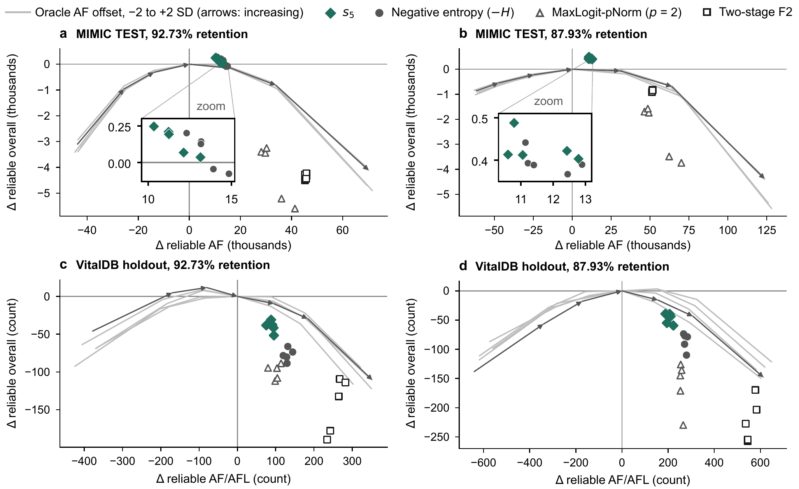
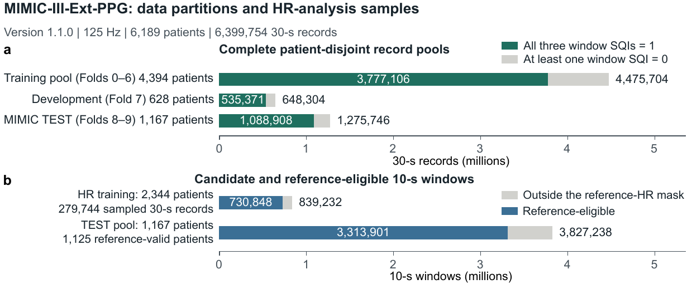
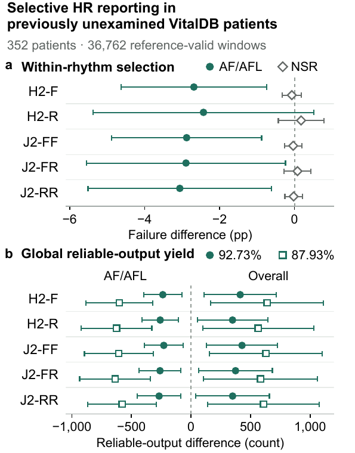

# Selective PPG-based heart-rate reporting

### Separating within-rhythm accuracy from reliable-output yield

[](https://github.com/xianjin-lin/selective-ppg-hr-reporting/actions/workflows/checks.yml)

**Partial analysis release · CPU-only examples · No patient-level data · No plotting code**

This research companion studies a distinction that matters when heart-rate
estimates are selectively reported: **a score can select more accurate estimates
within a cardiac rhythm while retaining fewer reliable outputs from that rhythm
under a shared reporting budget.**

The associated manuscript compares confidence- and quality-based selection on
fixed 10-second PPG heart-rate predictions from five supervised configurations.
MIMIC-III-Ext-PPG supports the development evidence; an additional,
rhythm-annotated VitalDB cohort evaluates the allocation pattern under analysis
rules frozen before waveform retrieval.



*Allocation trade-offs in the manuscript. Points are descriptive configuration-level
three-seed means, not individual patients or confidence intervals. Label-informed
offset curves are diagnostics, not deployable rhythm-blind corrections.*

## Start here

- [Run the data-free example](#quick-start-no-data-application-required)
- [Understand the release boundary](#what-is-and-is-not-released)
- [Obtain the datasets](#data-access-and-permissions)
- [Analyze your own predictions](#analyze-local-predictions)
- [Read the statistical contract](docs/analysis-contract.md)
- [Inspect aggregate manuscript results](results/published/README.md)

## Research question

Selective reporting should be assessed along three axes:

| Quantity | Question answered |
|---|---|
| Retained failure | How often do reported estimates fail the error tolerance? |
| Rhythm-specific coverage | What fraction of each rhythm's eligible windows is retained? |
| Reliable-output yield | How many retained estimates are non-failing, within a rhythm or overall? |

Failure includes a missing/non-finite prediction or an absolute HR error **above
5 bpm** against the ECG-derived reference. Exactly 5 bpm is not a failure.
Reference eligibility is applied separately, before comparing reporting rules.
The study's rhythm labels and reference-HR definitions are not diagnoses made by
this repository.

<details>
<summary><strong>Study design and external evaluation</strong></summary>



*Manuscript data-partition figure. MIMIC TEST had previously been examined and is
not presented as independent confirmation.*



*Manuscript external-cohort figure. Points are configuration-level three-seed
mean confidence-minus-quality differences. Whiskers are approximate simultaneous
95% subject-cluster bootstrap intervals within each contrast family (352
patients; 20,000 resamples). Overall counts include AF/AFL. The original
confidence-versus-quality comparison and subsequent exploratory score
adjustments have different evidence status; see the manuscript and notes below.*

</details>

## Quick start: no data application required

Python 3.11 or newer is required. The analysis examples need only NumPy, not
PyTorch, a GPU, model checkpoints, or medical-data credentials.

```bash
git clone https://github.com/xianjin-lin/selective-ppg-hr-reporting.git
cd selective-ppg-hr-reporting
python -m venv .venv
```

Activate the environment using the command for your shell:

```bash
# Linux / macOS
source .venv/bin/activate
```

```powershell
# Windows PowerShell
.\.venv\Scripts\Activate.ps1
```

Then install the analysis dependency and run:

```bash
python -m pip install -r requirements.txt
python examples/run_demo.py
python -m unittest discover -s tests -v
```

The deterministic example constructs **12 synthetic units, two configurations,
three paired seeds, and 240 windows per fit**. At 75% retention it demonstrates
more reliable outputs overall but fewer reliable AF outputs under confidence
than under quality ranking. This is an intentionally constructed software
example, **not patient data and not a reproduction of a clinical effect size**.

Outputs are written locally to `outputs/demo/`:

- `synthetic_predictions.csv`: the generated test input;
- `summary.json`: endpoint contrasts, global reporting levels and bootstrap settings.

The demo uses 2,000 bootstrap draws for a short software run. The manuscript's
families, operating points and convergence/escalation rules must be followed
when reproducing its inferential analyses. The published result files are not
silently replaced by demo outputs.

## What is and is not released

| Included | Not included |
|---|---|
| Matched-count top-k selection and deterministic tie handling | Model training and inference implementations |
| Failure definition and subject-level contrast arithmetic | Model checkpoints, logits or prediction caches |
| Fixed-set paired cluster bootstrap and family intervals | Raw or processed patient-level waveforms |
| A local CSV analysis entry point and synthetic example | Restricted MIMIC files, identifiers or access credentials |
| Aggregate result tables and selected rendered manuscript figures | **All figure-generation and plotting scripts** |
| An official open-data download/schema-check example | The complete private research workspace or its history |

This is a **partial analysis companion**, not the complete experimental system.
The synthetic example verifies released computations. It does not train the
five estimators or regenerate all manuscript figures, tables or clinical
results. Having approved access to the original datasets does not supply the
unreleased models or their predictions. No future release of withheld
components is promised here.

## Data access and permissions

**No original dataset is redistributed in this repository.** Follow the terms
of the provider and exact version you obtain; repository code permissions do
not grant permission to use third-party data.

| Resource | Official access route | Application needed? | Role |
|---|---|---|---|
| MIMIC-III-Ext-PPG 1.1.0 | [PhysioNet](https://physionet.org/content/mimic-iii-ext-ppg/1.1.0/) · [DOI](https://doi.org/10.13026/r6k1-xt76) | **Yes: credentialing, required training and signed DUA** | Source data for fitting/development and MIMIC evaluation |
| VitalDB 1.0.0 | [PhysioNet](https://physionet.org/content/vitaldb/1.0.0/) · [DOI](https://doi.org/10.13026/czw8-9p62) | Open access under that version's CC BY 4.0 license | External-source waveform data |
| VitalDB Arrhythmia 1.0.0 | [PhysioNet](https://physionet.org/content/vitaldb-arrhythmia/1.0.0/) · [DOI](https://doi.org/10.13026/axd6-wm13) | Open access under CC BY 4.0 | Expert beat/rhythm annotations for the additional cohort |

### MIMIC: apply yourself, do not share credentials

1. Create or use your own PhysioNet account.
2. Complete its current credentialing and required research training.
3. Sign the dataset's Data Use Agreement and wait for access approval.
4. Download from the official project while authenticated using your own account.
5. Keep all downloaded records, IDs, access tokens and derived patient-level
   caches outside Git. Do not upload them to an issue or pull request.

This project neither automates approval nor bypasses access controls. It does
not ask you to paste a password/token into a script, issue, notebook or README.

### One-command open-data example

```bash
python examples/download_open_annotations.py
```

This retrieves one official VitalDB Arrhythmia annotation file (the provider's
example case 337), its license and checksum list from **PhysioNet 1.0.0**.
It verifies upstream SHA-256 values and checks the annotation schema, then
saves local files and a row-count report under `data/`. It downloads no MIMIC
data and requires no key. The report counts annotation rows, not rhythm
duration or HR-estimation performance. It does not run an HR model.

For raw VitalDB waveforms use the official PhysioNet record linked above.
The VitalDB website and API are separate distribution routes and can display
different terms. Do not assume that a license on one route governs another.
The included downloader therefore uses only the explicitly versioned,
open-access PhysioNet annotation release. See [data-access details](docs/data-access.md).

## Analyze local predictions

Supply your own lawfully held, aligned predictions in the documented
[CSV format](docs/analysis-contract.md#input-format):

```bash
python run_analysis.py --input outputs/demo/synthetic_predictions.csv --fraction 0.75 --bootstrap 2000 --output outputs/check
```

For your own data replace the input path and choose the retention fraction
**before examining comparison outcomes**. Outputs contain aggregate quantities,
not window or patient identifiers. AF labels are `AF` or `AF/AFL`, and the exact
sinus-rhythm label is `SR`. Other rhythm labels remain in the global pool.
Do not relabel non-SR rhythms as SR for convenience.

The command evaluates one operating point and two clearly named demonstration
families. It is not a replacement for the manuscript's complete prespecified
analysis specification. In particular, the paper's SQI-defined within-rhythm
counts are not automatically recovered from an arbitrary CSV fraction.

## Statistical interpretation

- Predictions stay fixed when comparing reporting rules.
- Ranking is descending; score ties use stable input order.
- Retained counts use `floor(fraction * n + 0.5)`.
- Patients/subjects, **not windows or random seeds**, are the bootstrap units.
- Seed-level statistics are averaged within each resample, using the same
  subject weights for both policies and all contrasts.
- Retained sets are selected once on the observed cohort. The bootstrap
  reweights subjects; it **does not rerun top-k selection**.
- These intervals are conditional on the observed selected sets. They do not
  estimate the behavior of a reselected policy in a newly composed cohort.
- Raw reliable-output counts and budget-standardized sensitivities have
  different resampling targets even when their observed point estimates agree.
- An interval spanning zero does not establish equivalence. Descriptive
  diagnostics do not establish miscalibration or a biological mechanism.

See [the statistical contract](docs/analysis-contract.md) for endpoints,
directions, missingness, family exclusions and the release boundary.

## Repository map

```text
analysis_core.py                  Released pure numerical routines
run_analysis.py                   Local CSV analysis entry point
examples/run_demo.py              Reproducible synthetic case
examples/download_open_annotations.py  Official open-data access example
tests/test_analysis.py            CPU-only regression checks
results/published/                Aggregate manuscript result snapshots
assets/                          Rendered figures only, no plotting sources
docs/                            Data access, interpretation and provenance
```

## Citation and status

Associated manuscript: **Selective PPG-based heart-rate reporting: Separating
within-rhythm accuracy from reliable-output yield**.

Authors: Xianjin Lin, Liyang Yu, Zhonglou Luo, Rui Tian and Wangcai Ding.
This repository does not claim journal acceptance or supply an invented
publication DOI. Use [CITATION.cff](CITATION.cff) to cite this software snapshot,
and cite the original dataset providers when using their data.

## Rights and responsible use

This release excludes the unpublished training, inference and plotting code.
See [RIGHTS.md](RIGHTS.md) for the separation of code, figures and third-party
data. Sharing this selected analysis code does not license unreleased project
components or grant access to the original datasets.

Research use only: this analysis companion is not a medical device, diagnostic
tool, or a validated real-time monitoring system. Please use GitHub issues for
reproducible **non-sensitive** software problems; never attach patient records,
credentials, model caches or identifiable screenshots.
